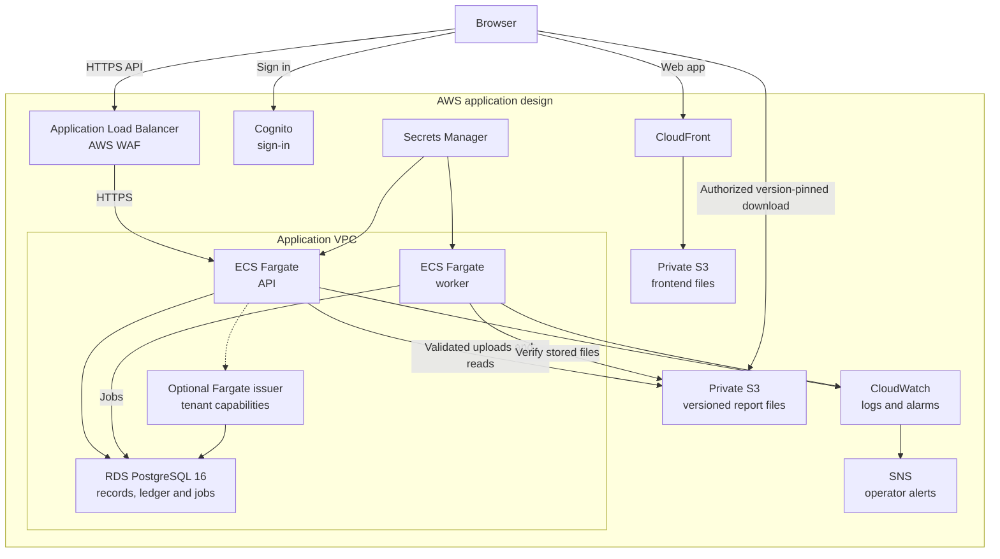

# Telesphoros

CPIC-guided pharmacogenomic (PGx) decision support at the point of care.
Cuadrado Zayas Infrastructure LLC, San Juan, PR.

> **Clinical disclaimer.** This is a clinical decision *support* service. It
> does not prescribe, dispense, or replace clinician judgment. Recommendations derive
> from versioned CPIC guidelines in `knowledge/`; any model output is grounded in
> those rules and disabled until clinical sign-off.

**Status:** under construction, **synthetic data only**. Real-data and clinical-use release gates remain closed. The reader and the engine
that run the lab-report pipeline are test-only and nothing here is approved for clinical use. What is built, what is in flight and what is
waiting on a person: [docs/STATUS.md](docs/STATUS.md).

## Start here

Follow [the quick start](docs/start-here.md) to run the local storage demo: sign in, add a synthetic patient, upload a repository fixture and
find it in Reports. It uses a disposable PostgreSQL cluster, a local S3 emulator and the fake identity provider. Clinical processing stays disabled.
Then use [the documentation map](docs/README.md), [architecture](docs/architecture.md) and [glossary](docs/glossary.md).

Before you touch staging or ask for a credential, read [what runs in AWS](docs/ops/environments.md) (the record that wins over older pages) and
[team access](docs/ops/team-access.md) (what needs no credentials, and what waits for one). Which build shows which screen:
[current supported modes](docs/product-capabilities.md#current-supported-modes-2026-11-07).

## Infrastructure overview

This is the AWS application design declared in Terraform. Enabled components depend on the deployment profile and feature flags;
live deployment and operational acceptance are recorded separately in the [hosting](docs/ops/api-hosting.md) and
[staging](docs/ops/staging-rehearsal.md) procedures.

Uploads pass through the API; authorized downloads name an exact stored file version. Cognito establishes identity, while database
membership supplies authority. The issuer has its own enable switch and TLS prerequisites.

The production profile uses operator-supplied private application/database subnets. The optional synthetic network uses public subnets
and task IPs for a disposable rehearsal; RDS remains non-public in both profiles. See [network/profile rules](infrastructure/terraform/profile.tf).

Supporting infrastructure includes [ECR and image signing](infrastructure/terraform/signing.tf), [KMS encryption](infrastructure/terraform/kms.tf),
[CloudTrail audit evidence](infrastructure/terraform/audit.tf) and the separate [S3/KMS Terraform state root](infrastructure/terraform-state/README.md).
Resource and connection sources: [web](infrastructure/terraform/web.tf), [API edge](infrastructure/terraform/api-edge.tf),
[API compute](infrastructure/terraform/api-compute.tf), [database](infrastructure/terraform/database.tf), [report storage](infrastructure/terraform/storage.tf),
[worker](infrastructure/terraform/worker.tf) and [issuer](infrastructure/terraform/issuer.tf). Deployment prerequisites are in the
[Terraform guide](infrastructure/terraform/README.md).

## Layout
| Path | Purpose |
| --- | --- |
| `apps/frontend` | Clinician-facing UI (Vite, React, Tailwind). Entry: [`src/main.tsx`](apps/frontend/src/main.tsx), then [`src/app/routes.tsx`](apps/frontend/src/app/routes.tsx) |
| `apps/backend` | NestJS API: tenancy, authentication, reports and uploads, the lab-report pipeline, the records and audit ledger, the phenotype and recommendation engines, backup and restore. Entry: [`src/main.ts`](apps/backend/src/main.ts), then [`src/app.module.ts`](apps/backend/src/app.module.ts). It also holds two optional entry points: the [issuer](apps/backend/src/issuer/main.ts) (its own enable switch) and the gated [evaluation worker](apps/backend/src/evaluation-worker.ts) |
| `apps/worker` | A separate process: the queue consumers and the scheduler (upload sweep, stored-file checks, expired-capability removal). Entry: [`src/main.ts`](apps/worker/src/main.ts). Not the same thing as the evaluation worker above. See [jobs](docs/ops/jobs.md) |
| `apps/ai-service` | A **library**, not a service: synthetic control flow, explanation contracts, policy/budget checks and evaluations. It has no model, no process and no deployment |
| `packages/` | `shared-types` (API contracts), `cpic-schema` (knowledge and engine schemas), `jobs` (queue and runner primitives the backend and worker share), `smart-pilot` (a local, synthetic-only SMART/FHIR rehearsal with its own [`src/start.ts`](packages/smart-pilot/src/start.ts): the one package you run rather than import), `fake-idp` (test identity provider, never deployed), `fhir-utils` (empty placeholder) |
| `knowledge/` | Clinical-reference content and reader integration; real content and the optional reader remain gated. `knowledge/schemas` is an empty placeholder: the real schemas are in `packages/cpic-schema` |
| `sidecars/report-lookup` | Three files for the offline conformance tests of report lookup: a restricted JSON/hash oracle, its frozen vectors and a mutation test. They run in tests, never in the product ([results](docs/clinical-validation/report-lookup-offline-v1.md)) |
| `sidecars/report-reader` | **Not in this public checkout.** The Python wrapper for the imported reader engine is optional and private; see "What the public checkout can and cannot run" below |
| `tests/` | Hand-written expected results (`report_adapter`, `report_reader`, `clinical_scenarios`) and backup fixtures. `tests/e2e` holds only a `.gitkeep`: the browser suites are under `apps/frontend` |
| `ml/` | Model training, evaluation, model cards (not started; empty scaffolding) |
| `data/` | **Synthetic data only**, including the test-only knowledge the adapter tests use |
| `infrastructure/` | Terraform application and state roots, deployment profiles and security guard tests |
| `scripts/` | Automation grouped by purpose: `local-storage/` (the demo), `local-review/`, `staging/` (release and status), `workspace-build/`, `lint/`. The root `package.json` exposes a subset as `pnpm` commands |
| `specs/` | Numbered feature specifications. Architecture decisions are in `docs/adr/`; what runs now is in [environments.md](docs/ops/environments.md) |
| `docs/` | Architecture, status, design specifications, operations runbooks |

### What the public checkout can and cannot run
| | Public checkout |
| --- | --- |
| Local storage demo, all default checks, the database/S3 tiers, the worker suites | Can run (disposable local services; see [start-here](docs/start-here.md) and the [verification matrix](docs/database.md#verification-matrix)) |
| The five backend specs of the imported reader engine, the local review demo, the lab-report pipeline | Cannot: the engine and `sidecars/report-reader` are private. The specs skip and print `[jest] ENGINE ABSENT`; `LAB_REPORT_PIPELINE=enabled` stops at start with a message naming the missing files ([why](docs/lab-report-reader.md#the-engine-is-optional)) |
| Anything in AWS, a staging release | Cannot without an individually provisioned role ([team access](docs/ops/team-access.md)) |

## Working on it
- Install: `pnpm install --frozen-lockfile` (pnpm 10.28.0; Node is pinned to an exact release in CI, see [docs/ops/ci-cd.md](docs/ops/ci-cd.md)).
- Checks that every pull request must pass: `pnpm typecheck`, `pnpm lint`, `pnpm test`, `pnpm build`, `pnpm test:infra`, `pnpm test:ci-config`, `pnpm check:workflows`.
- The backend has **three test tiers**: in-memory (no services), PostgreSQL (`TEST_DATABASE_URL`, start one with
  `apps/backend/scripts/dev-postgres.sh start`), and PostgreSQL plus an S3 emulator (`TEST_S3_ENDPOINT`). CI runs the real-service tiers on every
  code pull request; the standalone PostgreSQL-store profile runs only in the nightly. A plain `pnpm test` skips the service tiers and says so.
  The command, prerequisite, skip notice and PR-versus-nightly coverage of each: the [verification matrix](docs/database.md#verification-matrix);
  see also [apps/backend/README.md](apps/backend/README.md).
- How we work, and the rules that are not negotiable: [CONTRIBUTING.md](CONTRIBUTING.md) and the working agreements in [docs/STATUS.md](docs/STATUS.md).

## Data rules
No real PHI in git, `data/`, or `ml/`. Training data is synthetic or de-identified only. No secret is ever committed or printed.
