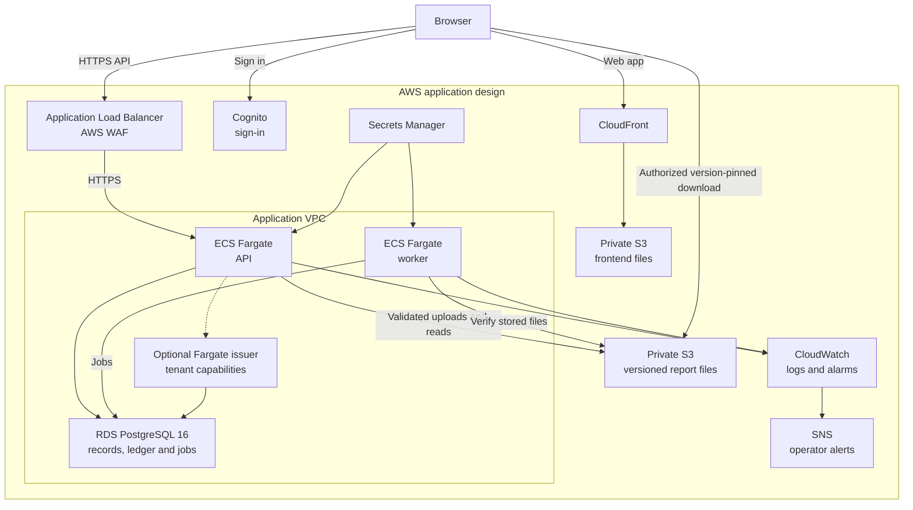

# Telesphoros

CPIC-guided pharmacogenomic (PGx) decision support at the point of care.
Cuadrado Zayas Infrastructure LLC, San Juan, PR.

> **Clinical disclaimer.** This is a clinical decision *support* service. It
> does not prescribe, dispense, or replace clinician judgment. Recommendations derive
> from versioned CPIC guidelines in `knowledge/`; any model output is grounded in
> those rules and disabled until clinical sign-off.

**Status:** under construction, **synthetic data only**. Real-data and clinical-use release gates remain closed. The reader and the engine
that run the lab-report pipeline are test-only and nothing here is approved for clinical use. What is built, what is in flight and what is
waiting on a person: [docs/STATUS.md](docs/STATUS.md).

## Start here

Follow [the quick start](docs/start-here.md) to run the local storage demo: sign in, add a synthetic patient, upload a repository fixture and
find it in Reports. It uses a disposable PostgreSQL cluster, a local S3 emulator and the fake identity provider. Clinical processing stays disabled.
Then use [the documentation map](docs/README.md), [architecture](docs/architecture.md) and [glossary](docs/glossary.md).

## Infrastructure overview

This is the AWS application design declared in Terraform. Enabled components depend on the deployment profile and feature flags;
live deployment and operational acceptance are recorded separately in the [hosting](docs/ops/api-hosting.md) and
[staging](docs/ops/staging-rehearsal.md) procedures.

Uploads pass through the API; authorized downloads name an exact stored file version. Cognito establishes identity, while database
membership supplies authority. The issuer has its own enable switch and TLS prerequisites.

The production profile uses operator-supplied private application/database subnets. The optional synthetic network uses public subnets
and task IPs for a disposable rehearsal; RDS remains non-public in both profiles. See [network/profile rules](infrastructure/terraform/profile.tf).

Supporting infrastructure includes [ECR and image signing](infrastructure/terraform/signing.tf), [KMS encryption](infrastructure/terraform/kms.tf),
[CloudTrail audit evidence](infrastructure/terraform/audit.tf) and the separate [S3/KMS Terraform state root](infrastructure/terraform-state/README.md).
Resource and connection sources: [web](infrastructure/terraform/web.tf), [API edge](infrastructure/terraform/api-edge.tf),
[API compute](infrastructure/terraform/api-compute.tf), [database](infrastructure/terraform/database.tf), [report storage](infrastructure/terraform/storage.tf),
[worker](infrastructure/terraform/worker.tf) and [issuer](infrastructure/terraform/issuer.tf). Deployment prerequisites are in the
[Terraform guide](infrastructure/terraform/README.md).

## Layout
| Path | Purpose |
| --- | --- |
| `apps/frontend` | Clinician-facing UI (Vite, React, Tailwind) |
| `apps/backend` | NestJS API: tenancy, authentication, reports and uploads, the lab-report pipeline, the records and audit ledger, the phenotype and recommendation engines, backup and restore |
| `apps/ai-service` | Synthetic LLM harness, explanation contracts, policy/budget checks and evaluations |
| `packages/` | `shared-types` (API contracts), `cpic-schema` (knowledge and engine schemas), `fake-idp` (test identity provider), `fhir-utils` (placeholder) |
| `knowledge/` | Clinical-reference content and reader integration; real content and the optional reader remain gated |
| `sidecars/report-reader` | The Python wrapper that runs the imported reader engine |
| `tests/` | Hand-written expected results (`report_adapter`, `report_reader`, `clinical_scenarios`), backup fixtures, end-to-end |
| `ml/` | Model training, evaluation, model cards (not started) |
| `data/` | **Synthetic data only**, including the test-only knowledge the adapter tests use |
| `infrastructure/` | Terraform application and state roots, deployment profiles and security guard tests |
| `docs/` | Architecture, status, design specifications, operations runbooks |

## Working on it
- Install: `pnpm install --frozen-lockfile` (pnpm 10.28.0; Node is pinned to an exact release in CI, see [docs/ops/ci-cd.md](docs/ops/ci-cd.md)).
- Checks that every pull request must pass: `pnpm typecheck`, `pnpm lint`, `pnpm test`, `pnpm build`, `pnpm test:infra`, `pnpm test:ci-config`.
- The backend has **three test tiers**: in-memory (no services), PostgreSQL (`TEST_DATABASE_URL`, start one with
  `apps/backend/scripts/dev-postgres.sh start`), and PostgreSQL plus an S3 emulator (`TEST_S3_ENDPOINT`). CI runs all three; see
  [docs/database.md](docs/database.md) and [apps/backend/README.md](apps/backend/README.md).
- How we work, and the rules that are not negotiable: [CONTRIBUTING.md](CONTRIBUTING.md) and the working agreements in [docs/STATUS.md](docs/STATUS.md).

## Data rules
No real PHI in git, `data/`, or `ml/`. Training data is synthetic or de-identified only. No secret is ever committed or printed.
