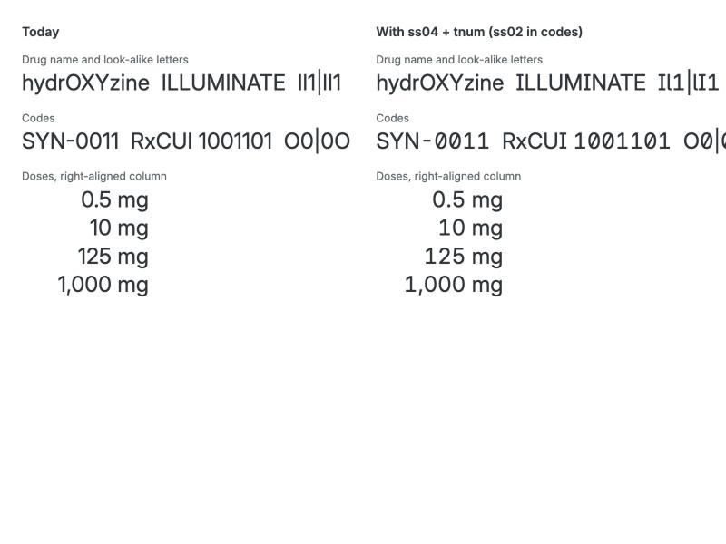

# Typography in clinical software: what others use, and what to change here

Date: 2026-11-15. Asked by the founder: "check what fonts are used on clinical softwares so we can replicate and offer a better user experience". Any change needs the founder's approval and a reviewed update to `apps/frontend/scripts/branding-policy.json` ([branding.md](branding.md)).

**Decision, 2026-11-15:** the founder approved recommendation 2 ("Yes, switch them on"). Done on this branch: a locked token `--font-feature-ui: "ss04"` in `tokens.css` and in the branding policy, applied to the signed-in app (`.workspace-shell`) and not to the landing page; tabular numbers in every `table`; and the slashed zero (Tailwind `slashed-zero`) on patient codes in the patient list, the chat home's follow-ups and a follow-up entry. The Follow-ups list gets it when the navigation branch, which rewrites that file, is merged. No font file changed. Recommendations 3 to 5 are not started.

**Labels.** **V**: re-read by the author of this note on the page, repository file or PubMed record on 2026-11-15. **S**: read by the research subagent only. **M**: measured here in the app's own font file.

## What clinical and health design systems use

| System | Typeface and fallback | Body size | Numerals | Source | Label |
|---|---|---|---|---|---|
| NHS (England) | Frutiger, then Arial | 19 px desktop, 16 px mobile | No guidance | service-manual.nhs.uk/design-system/styles/typography | V |
| Oracle Health (Cerner) Terra | Helvetica Neue, Helvetica, Arial | 87.5% root (14 px), line height 1.43 | No feature settings | github.com/cerner/terra-core, `terra-base/src/Base.scss` | V |
| VA.gov | Public Sans (body and headings), Roboto Mono | 1 rem, line height 1.5 | Monospace for numbers in tables (percentages, currency, totals), not for phone numbers, ZIP codes or dates | design.va.gov/foundation/typography | V |
| US Web Design System | Public Sans, Source Sans Pro, Merriweather, Roboto Mono | at least 16 px; 45 to 90 characters a line | Public Sans has tabular numerals | designsystem.digital.gov/components/typography | S |
| CMS Design System | Open Sans, Helvetica, Arial, Verdana | 16 px, minimum 14 px | — | design.cms.gov/foundation/typography/overview | S |
| Carbon (base of OpenMRS O3) | IBM Plex Sans, Serif, Mono | — | — | carbondesignsystem.com; OpenMRS esm-core README | S; Plex in O3 unverified |
| Epic, athenahealth | Not published for the product UI (athenahealth's brand guide is marketing only) | — | — | — | S |

Every system surveyed uses a neutral sans serif with a system fallback. None names a typeface for clinical reasons, and none sets OpenType features.

## What the safety evidence says

- **Tenfold dose errors come from digits and decimals, not typefaces.** In 200 consecutive tenfold prescribing errors, 43.5% came from a misplaced decimal point, 31.5% from an extra zero and 25% from an omitted zero (Lesar 2002, PMID 12452740, V). A paediatric series of 252 found decimal points and zeros among the frequent causes (Doherty 2012, PMID 22473367, V). FDA's container and carton label guidance (2022) asks for no trailing zero, a leading zero before a decimal, and commas from 1,000, and warns against thin or condensed fonts (S).
- **Tall Man helps a little.** A systematic review found Tall Man "marginally effective", in laboratory studies only, with a likely awareness effect (Bryan 2020, PMID 33197079, V). Another found lower error rates in 6 of 11 Tall Man studies, higher in 1, and no effect in the one hospital study (Larmené-Beld 2018, PMID 29754215, V). Colour and highlighting beyond Tall Man reduced look-alike recognition errors (Simas da Rocha 2021, PMID 32251242, V). ISMP's 2025 guidelines for electronic systems ask for lowercase generic names with bold upper-case Tall Man, and adequate space between drug, dose, unit, route and frequency (S).
- **Size matters more than face.** Fluent reading holds over x-heights of about 0.2 to 2 degrees (Legge and Bigelow 2011, PMID 21828237, V). The humanist-versus-grotesque advantage measured so far comes from glance tasks in cars and was modest: 10.6% less glance time for men, unclear for women (Reimer 2014, PMID 25075429; Dobres 2016, PMID 26727912, V). That is not a reason to change typeface.

## Telesphoros today

- **Inter Variable v4.1**, bundled (`apps/frontend/src/assets/fonts/InterVariable.woff2`), for all application text; Poppins only for the wordmark (`src/styles/tokens.css:63-66`). It matches what the surveyed systems do: a neutral sans with an Arial fallback.
- **No OpenType features are switched on.** Measured in the browser against the bundled file (M), the features below are present and change the glyphs: `ss02` and `ss04` (disambiguation), `cv05` (l with tail), `cv08` (I with serif), `zero` (slashed zero), `tnum` (tabular numbers). Inter's site documents `ss02` as "Disambiguation" and `ss04` as "Disambiguation (no zero)" (V).
- **Small text is common.** `text-sm` (14 px) appears 275 times and `text-xs` (12 px) 93 times in `components` and `pages`. 12 px is below the CMS minimum of 14 px; much of it carries status and help text.
- Doses are not captured today (spec 029 D1, capture-only), so the dose-format rules apply to any future dose or lab value display, not to a screen that exists now.

*Left, today. Right, with `ss04` and `tnum`, and `ss02` in codes: "Il1" becomes distinct, codes get a slashed zero, and dose digits line up.*

## Recommendation

1. **Keep Inter.** No clinical evidence favours another face, and every surveyed system uses an equivalent neutral sans. Changing it would cost a brand review for no measured benefit.
2. **Turn on disambiguation everywhere and tabular numbers where numbers are compared:** `font-feature-settings: "ss04"` on application text, `"ss02"` (adds the slashed zero) on codes and identifiers (patient codes, RxCUIs, report ids), and `"tnum"` on tables, counts and any dose or lab column. Not on dates or phone numbers, following VA. Same font file, no download. A tokens change, so it needs approval and the branding policy update.
3. **Format numbers to the FDA and ISMP rules** wherever a dose or lab value is ever shown: leading zero, no trailing zero, thousands separator, a space between number and unit. This is where the harm evidence is, and no typeface fixes it.
4. **Raise the floor for small text:** no 12 px text for anything a clinician must read to act (status, warnings, help that changes a decision); keep 12 px only for incidental metadata. A separate, larger change: 93 uses to review.
5. **Keep Tall Man, and add a second cue for look-alike pairs** when a list shows both members (for example a muted note "look-alike name"), since the reviews find Tall Man alone marginal. Needs its own design decision.

## Not verified here

USWDS, CMS, Carbon and OpenMRS rows (S); the ISMP guideline content and FDA guidance text (S); whether Inter is classed as humanist. The ACSQHC on-screen display guidelines could not be opened. Re-read before quoting.

## Sources (PubMed)

Bryan 2020 [10.1111/bcp.14644](https://doi.org/10.1111/bcp.14644); Larmené-Beld 2018 [10.1007/s00228-018-2471-z](https://doi.org/10.1007/s00228-018-2471-z); Simas da Rocha 2021 [10.1097/PTS.0000000000000619](https://doi.org/10.1097/PTS.0000000000000619); Lesar 2002 [10.1345/aph.1C032](https://doi.org/10.1345/aph.1C032); Doherty 2012 [10.1542/peds.2011-2526](https://doi.org/10.1542/peds.2011-2526); Legge 2011 [10.1167/11.5.8](https://doi.org/10.1167/11.5.8); Reimer 2014 [10.1080/00140139.2014.940000](https://doi.org/10.1080/00140139.2014.940000); Dobres 2016 [10.1080/00140139.2015.1137637](https://doi.org/10.1080/00140139.2015.1137637); Sawyer 2020 [10.1080/00140139.2020.1714748](https://doi.org/10.1080/00140139.2020.1714748).
