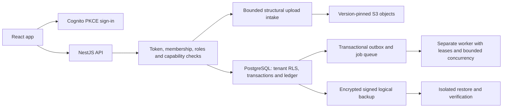

# Production readiness: code, security and reliability

Date: 2026-11-01 (America/Puerto_Rico). Public Telesphoros; base `45ce0af1f0ce5eb3bedf05e9a48e8b31cf7da1cc`; local branch `fix/production-readiness`. The founder approved a full-application review of all nine supplied areas. This branch is independent of the pending UX and consent candidates. AI assistance: Codex inspected source, wrote the fixes and tests, and evaluated the recorded results. No deployment, push or PR is included.

**Verdict: Not ready for a production/clinical launch.** This is a code-level and isolated-service assessment, not hosted acceptance or a HIPAA certification. The public reader engine is absent, the lab pipeline and queued evaluations explicitly refuse production configuration, and reviewed production knowledge/clinical acceptance remain separate gates. Existing synthetic staging is not evidence that those gates are satisfied. The specific local repairs below do not grant production permission.

Status vocabulary: **Fixed** = reproduced before repair and regression passed; **Existing** = code/control identified, with the verification tier stated; **Conditional** = a limitation or decision remains; **Not tested** = no live/representative evidence; **Not applicable** = no such application feature. No skipped requirement counts as passed.

## Critical flows traced in source

| Flow | Actual implementation and boundaries |
| --- | --- |
| Sign-in and protected reads | [Auth client](../../apps/frontend/src/auth/authClient.ts), [authenticated transport](../../apps/frontend/src/auth/AuthProvider.tsx), [guard registration](../../apps/backend/src/auth/auth.module.ts), [Cognito verifier](../../apps/backend/src/auth/cognito-token-verifier.ts), [database capability/authority checks](../../apps/backend/src/db/database.ts). Tokens stay in memory; membership is not inferred solely from token roles. Test HMAC identities are outside the production configuration. |
| Patient creation | [API helper](../../apps/frontend/src/lib/api.ts), [service](../../apps/backend/src/patients/patients.service.ts), [repository](../../apps/backend/src/storage/postgres/patients.repository.ts): request UUID + payload identity, tenant/actor-scoped replay and database uniqueness. A new button lock cannot replace these controls. |
| Report upload/recovery/download | [Upload coordinator](../../apps/frontend/src/lib/ownedStorageApi.ts), [recovery metadata](../../apps/frontend/src/lib/uploadRecovery.ts), [controller](../../apps/backend/src/reports/reports.controller.ts), [intake](../../apps/backend/src/reports/intake/intake.service.ts), [stager](../../apps/backend/src/reports/intake/stage.ts), [S3 adapter](../../apps/backend/src/object-storage/s3-object-storage.ts). Validate raw bytes before storage; pin checksum/version; reconcile an uncertain attempt rather than blindly send it again. |
| Capture, review and evaluation | [Capture service](../../apps/backend/src/lab-reports/captures.service.ts), [evaluation service](../../apps/backend/src/lab-reports/evaluations.service.ts), [request admission](../../apps/backend/src/storage/postgres/evaluation-requests.repository.ts). Independent review, source/version checks, transactions and the ledger apply; this pipeline is not production-enabled. |
| Jobs and recovery | [Queue](../../packages/jobs/src/queue.ts), [runner](../../packages/jobs/src/runner.ts), [ticker](../../apps/worker/src/scheduler.ts), [backup](../../apps/backend/src/db/backup.ts), [restore](../../apps/backend/src/db/restore.ts). At-least-once work requires idempotent handlers; a successful queue claim is not proof of a completed effect. |

## Readiness matrix

| Requirement | Status | Severity of remaining gap | Evidence | Remaining action |
| --- | --- | --- | --- | --- |
| 1. Limits, quotas and cost | Existing + Fixed + Conditional | High | Guard/token-bucket, WAF and upload reservations; worker ticker repaired | Exact fleet/user quotas, retained-byte budgets and a queue-depth policy are not established by per-process limits or alarms. |
| 2. Errors, loading and timeouts | Fixed + Existing | Medium | Browser/S3/database deadline regressions, existing input/error/session tests | Hosted outage behavior and representative latency acceptance still required. |
| 3. Duplicate submissions and stubs | Existing; payments N/A | High for clinical launch | Database replay/concurrency tests and production configuration gates | No payment provider exists; do not build fictional billing. Clinical engine/knowledge acceptance remains blocked. |
| 4. Database performance/pagination | Existing; measured locally | Medium | Real restricted-role EXPLAIN and pagination/concurrency suites | Offset pagination and exact counts still need production-sized acceptance; no speculative indexes added. |
| 5. File handling/compression | Existing + Fixed | High for provider acceptance | Raw intake, structural validator, S3 deadline and service tests; CloudFront compression declaration | Live object-lock/checksum/intake behavior and retained-storage growth require acceptance. |
| 6. Caching/reset requests | Existing; reset delegated | Medium | Global no-store, bounded JWKS cache, provider-hosted auth | Provider reset delivery/expiry/account-enumeration controls are not verified by this repo. |
| 7. Monitoring/logging | Existing code/config; hosted delivery Not tested | High | Health/readiness, projected structured logs and alarm definitions | Confirm subscriber, notification owner, external journey checks and actual safe alert delivery. |
| 8. Simultaneous users | Local rehearsal + existing races | High for capacity claims | Reproducible load script and real PostgreSQL/worker suites | No production capacity or long-soak claim; define forecast and repeat with hosted topology. |
| 9. Backup/restore | Local drill; provider recovery Not tested | High | Existing encrypted/signed restore, independent recovery and application recovery tests | Owner-approved RPO/RTO, provider/custodian drill, scheduling freshness and production-volume evidence. |

## Verified findings and repairs

| Finding | Failure scenario and impact | Repair and evidence |
| --- | --- | --- |
| R1: browser API calls had no overall deadline (Medium) | [AuthProvider.tsx:92](../../apps/frontend/src/auth/AuthProvider.tsx#L92): a connection that never settles can leave a critical screen pending indefinitely. | Combine caller cancellation with a 180-second outer deadline. Keep the deadline through response-body consumption; do not automatically retry writes or sign the user out on transport timeout. The conservative outer bound allows intake receiving/storing/verification, and is not a latency SLA. New stalled-request test failed before and passed after; caller-cancellation control also passes. |
| R2: incomplete S3 operation deadlines (High) | [s3-object-storage.ts:36](../../apps/backend/src/object-storage/s3-object-storage.ts#L36), [buffered writes:94](../../apps/backend/src/object-storage/s3-object-storage.ts#L94), [streamed writes:123](../../apps/backend/src/object-storage/s3-object-storage.ts#L123): buffered capture writes had no application abort deadline; a caller-supplied non-expiring signal could remove the read deadline. A stalled provider holds slots and requests. | Apply a 30-second abort deadline to buffered writes and combine it with caller signals for reads/streamed writes. Handle an already-aborted response body. A real SDK/local socket fixture stalls headers or a body; all three defects fail before repair. Existing versioning deadline is the positive control. Retry/lost-response tests remain intact. A timed-out write can still have succeeded remotely: intake recovery is authoritative. |
| R3: Retry-After hidden from cross-origin JavaScript (Medium) | [app.factory.ts:76](../../apps/backend/src/app.factory.ts#L76): the API sent a retry delay, but its CORS exposure omitted it. A browser cannot read that hint even on an allowed origin. | Expose `Retry-After` alongside the request ID. A real 429 test fails before and passes after; foreign origins still receive no access permission. This enables clients to read the hint; it does not add an automatic retry loop or claim every screen implements a countdown. |
| R4: stalled worker ticks accumulated (High) | [scheduler.ts:38](../../apps/worker/src/scheduler.ts#L38): every interval appended another promise behind an unfinished run. A prolonged dependency stall grows memory and creates a burst on recovery/shutdown. | Coalesce ticks onto the single active reconciliation. The controlled 60-tick regression produced 61 runs before repair; after repair it produces one, stops cleanly and permits a later independent run. Durable jobs/outbox rows remain in PostgreSQL; no business job is dropped by coalescing timer prompts. |
| R5: runtime database deadlines were insufficient on a half-open connection (High) | [database.ts:83](../../apps/backend/src/db/database.ts#L83): API/issuer pools lacked driver query timeouts; the verifier also needed a default statement bound outside its walk transaction. If responses cannot reach the client, the server's error cannot release the request/pool slot. | Add seven-second driver limits to API and issuer pools alongside their five-second statements, and a 35-second driver/30-second default statement bound to the ledger verifier. An established PostgreSQL wire peer suppresses every response: all three paths stay pending before their repair and end after it. Connection-unavailable behavior is preserved. This is not a total transaction deadline or proof that a timed-out COMMIT did not happen; no automatic write replay was added. |
| R6: backup coverage runbook was stale (Medium) | [backup-and-restore.md:9](../ops/backup-and-restore.md#L9) still described F2/F3 recovery as unimplemented although the real source and fresh local recovery receipts prove those paths exist. Operators could select the wrong recovery procedure. | Point the coverage row at the existing F2/F3 runbooks and distinguish tested local recovery from unverified provider/native/clinical acceptance. No provider capability or production RTO was inferred. |

Original failures and complete producer output are retained locally in `/private/tmp/readiness-*-before.log`; repaired runs use `*-after.log`. Sandbox socket denials were environmental failures, not defect reproductions; the real reproductions were rerun with loopback access. A dependency install initially failed DNS, then the isolated cache was incomplete; the pinned existing local pnpm cache installed successfully without changing dependencies or the lockfile.

## Each requested element: implementation, limitations and actions

### 1. Rate limits, quotas and spending caps

| Element | Assessment |
| --- | --- |
| Auth, reset, upload and expensive-route limits | Existing: IP limit runs before authentication; per-person read/write/expensive limits run after roles. Upload bytes are expensive. Sign-in/reset forms are provider-hosted, not custom API handlers. Provider quota/reset policies Not tested. |
| User/tenant/IP/system scope; multiple instances; proxy spoofing | Existing tenant+subject keys, bounded per-process buckets, explicit proxy hops and spoofing tests. WAF has an IP aggregate backstop. **Conditional:** these are not atomic fleet-wide per-user/tenant quotas; multiple processes each have their own buckets. WAF is approximate, not an exact financial cap. |
| Size, concurrency, queue depth, retries and jobs | Existing 100KB JSON limit, 10MiB raw report limit, two active intake slots/process, persistent upload reservation, bounded reader/worker concurrency, job attempts/timeouts/backoff and connection budgets. Fixed timer backlog. **Conditional:** no generic hard durable-queue depth cap was found; sustained admission must be sized against draining capacity. Do not discard the transactional outbox to impose a cosmetic cap. |
| Retry-After and provider quotas | Existing standard 429 envelope and retry delay; browser header exposure Fixed. SDK retry behavior has real lost-reply controls. No live AI/payment provider integration to rate-limit. |
| Concurrent spending reservations, alerts versus caps, kill switch | The AI package explicitly describes a synthetic control-flow library; its budgets do not establish a paid production cap. Existing pipeline/queued-evaluation production refusal is a real gate. **Conditional:** no fleet monetary/lifetime storage cap is claimed. Upload reserved bytes are not the cost of all retained versions/orphans, and clearing a reservation does not delete retained evidence. Founder must set ceilings, safe admission stop behavior and cost ownership before adding paid effects. No arbitrary dollar threshold or automatic evidence deletion was introduced. |
| Store unavailable/overshoot | Existing bucket state is memory, so there is no shared limiter store to test; restart/eviction resets are documented limitations. Upload inventory failure retains reservations and blocks unverified admission. Shared-store outage behavior and in-flight fleet overshoot remain unimplemented until that policy/store exists. |

### 2. Errors, loading, retries and timeouts

| Element | Assessment |
| --- | --- |
| Critical screen states and input preservation | Existing upload, patient selection, report detail and sign-in flows have loading/empty/error/retry tests. Trace `UploadReportPage`, `WorkspaceConversation`, `PatientPicker`, Reports and auth tests. The independent pending UX branch adds further polish and is not silently included here. No claim that every possible UI/network state was exhaustively enumerated. |
| Connection/request deadlines and cancellation | Fixed browser/S3/driver gaps above. Existing pool-acquisition, intake progress, reader process-tree and worker deadlines remain. The browser deadline uses active browser time and is not a server cancellation/rollback promise. |
| Safe transient retries, backoff/jitter and storm prevention | Existing job runner has bounded exponential/jittered claim backoff and finite attempts. SDK controls cover stream replay. Browser repair performs no automatic retry. Fixed ticker coalescing removes one recovery burst source. |
| Uncertain writes/payments | Existing patient/report request identity and upload-attempt status/resume reconcile uncertainty. Keep the same key after lost responses; reconcile state before another transfer. No payments exist. |
| Stale responses | Existing auth epoch/token identity fences and abortable page effects reject superseded work. Relevant regression/browser suites are the evidence, not an assumption that aborting the browser cancels a committed server action. |
| Central errors/correlation and safe responses | Existing request-ID middleware, fixed public error mapper, exception filter and projected Pino fields. Tests check refusal/error shapes and sensitive-value handling. No raw SDK/SQL messages are shown by the new behavior. |

### 3. Duplicate submissions, payments and stubs

| Element | Assessment |
| --- | --- |
| Forms, jobs and records | Existing backend request replay, unique keys, transactions, job-slot deduplication and transactional outbox; database race tests exercise multiple pools. Local workload additionally races 16 HTTP creates through two API instances. Button state is only a UI control. |
| Key scope, payload consistency and simultaneous requests | Existing tenant+actor request identity and payload hash checks; conflicting payload under a used key is refused. Repeated-key load evidence requires one stored row and one returned identity. |
| Webhook signatures, duplicates/order and uncertain payments | Not applicable: no payment provider, subscription flow or payment webhook was found in application code. Do not add a billing scaffold or assert payment readiness. |
| Mocks, stubs and unfinished paths | Fake IdP/HMAC auth and recorded/synthetic reader inputs belong to tests/development. Production config refuses unsafe auth/storage and the unfinished clinical pipeline. The AI service package is not a deployed inference endpoint. **Blocker for those product claims:** missing private reader, reviewed knowledge and clinical workflow acceptance. No stub was replaced with a hardcoded success response. |
| Restart/replay controls | Existing queue worker kill/drain/lease tests and record replay suites. Provider webhook replay is N/A. Hosted process restarts remain separate acceptance. |

### 4. Database performance and pagination

| Element | Assessment |
| --- | --- |
| N+1, columns, reads, transactions and pools | Existing explicit patient/report columns, bounded list reads, constant-statement query-plan measurements, finite pools, acquisition/statement limits and deployment connection budget. Fixed half-open response timeout. Exact count subqueries still scale with the filtered dataset. |
| Representative query plans | Existing real PostgreSQL suite seeds 1,500 patients/tenant for three tenants, two reports/patient plus histories; executes actual repository SQL with EXPLAIN ANALYZE BUFFERS as the restricted application role. This is a reproducible synthetic sample, not a production distribution. |
| Indexes and migrations | Existing plan/uniqueness controls are inspected and exercised; no new index or schema migration is justified by this repair. No write overhead or migration/rollback risk was invented to satisfy a checklist. |
| Pagination and concurrent changes | Existing enforced maximum 100, default 20, deterministic sequence ordering and history keyset pagination tests. Patient/report lists still use OFFSET; concurrent deletions can shift page boundaries. **Conditional:** move high-volume/changing feeds to cursors only with a contract migration and measured requirement; do not silently break existing page/meta consumers. |
| Authorization in reads/joins/counts/caches | Existing explicit tenant filters plus forced RLS and capability checks; service tier uses non-owner/non-superuser app roles. No cross-tenant data cache was added. |
| Migration safety/recovery | Existing numbered up/down migrations, compatibility labels and expand/breaking deployment rules. This candidate changes no schema; see rollback checklist. |

### 5. Files and compression

| Element | Assessment |
| --- | --- |
| Gateway/application limits and untrusted Content-Length | Existing WAF body rule plus explicit intake exception; application counts streamed bytes and enforces expected/maximum size independent of a header. Local raw-intake negative controls cover oversize/interruption. Live WAF behavior Not tested. |
| Type/content, filenames and authorization | Existing incremental structural validator, file-type allowlist, checksum, role/tenant checks and sanitized attachment disposition. Syntax validation is not a clinical, malware or full-format semantic certification; VCF acceptance must not be advertised as clinical interpretation. |
| Decompression/time/resource bounds | No general archive ingestion feature; do not introduce one. Existing bounded JSON/parser state, PDF/reader process budgets and streaming intake. Reject rather than add unbounded archive expansion. Actual format coverage is limited by the declared validator contract. |
| Streaming and abandoned uploads | Existing bounded writes/backpressure, staging ownership receipts, persistent attempts and worker cleanup. Retained/locked evidence is not deleted by the sweep; orphan retention has a cost consequence (area 1). Fixed S3 deadlines. |
| Compression and assets | Existing CloudFront static-asset compression/cache declarations and Vite asset/chunk gates. API responses remain private/no-store; no blanket compression of clinical responses or already-compressed report bodies was added. Hosted compression negotiation Not tested. |
| Actionable upload errors | Existing bounded validation/refusal messages, retained form/retry identity and uncertain-attempt resume. New timeouts do not imply the server rolled back. |

### 6. Caching and reset requests

| Element | Assessment |
| --- | --- |
| Suitable caches, TTL/bounds and invalidation | Existing public static asset cache and bounded JWKS cache (10-minute cache, unknown-key cooldown, 3-second key fetch). No patient/results SWR cache was added merely for speed; private API responses explicitly say no-store. |
| User/tenant/authorization cache keys and stale permissions | Authenticated record caching is absent, so shared PHI-key leakage/invalidation is avoided. Membership/version authority is checked through the existing database path; a new data cache would require explicit tenant, actor/role/version and invalidation contracts. |
| Stampedes, outages and sensitive responses | JWKS client has cooldown/cache behavior and authentication fails closed if usable verification keys are unavailable. Existing no-store middleware covers successful/refused/parse-error API responses. Hosted CDN/provider outage acceptance Not tested. |
| Purge/reset endpoints | No general public cache-purge endpoint was found. Operator commands remain separate privileged workflows. Not applicable to invent a reset API. |
| Password reset token/expiry/enumeration | Delegated to Cognito-hosted auth. No application-issued password-reset token exists. The [Cognito client declaration](../../infrastructure/terraform/cognito.tf#L119) enables user-existence-error prevention; its live state, reset token behavior and email/SMS delivery remain Not tested; do not label secure from absence of app code alone. |

### 7. Uptime, logs and incident response

| Element | Assessment |
| --- | --- |
| Meaningful liveness/readiness | Existing dependency-free liveness, bounded readiness dependency checks, migration/ledger readiness and worker health. Application tests prove refusal behavior; hosted routing/drain behavior needs acceptance. |
| External uptime and critical journey | Existing ALB/ECS checks are infrastructure health, not an external authenticated user journey. **Not tested/configured here:** an independent sign-in/create/upload/read synthetic journey and its notification destination. That must be approved for provider credentials, scope and cost. |
| Structured logs, correlation and metrics | Existing Pino projection, request IDs, latency/status fields, queue stats, CPU/memory/connection/worker/ledger alarms. No paid usage/cost telemetry is claimed for a synthetic AI library. Local load measures latency/error/throughput and process CPU/RSS. |
| Redaction and retention | Existing serializers omit paths/query strings/bodies and reduce driver errors; API/worker boundary tests cover this. Terraform log retention and object retention are declarations, not a live account audit. Synthetic logs/evidence only in this task. |
| Thresholds, owner and safe delivery verification | Existing alarm thresholds and SNS email subscription require confirmation. Actual subscriber confirmation, delivery, responder ownership and alert freshness are **Not tested**. Runbook below defines proposed acceptance/response; it does not send a message or modify an alarm. |

### 8. Simultaneous-user testing

| Element | Assessment |
| --- | --- |
| Reproducible workload and assumptions | New [local-load.cjs](../../scripts/readiness/local-load.cjs) owns its test database through existing fixtures; two API instances in one Node process, pools of four, three synthetic tenants and 20 initial patients each. Real PostgreSQL and HTTP; test token verifier/membership mirror; rate limiting off to measure application/database behavior. No external API traffic or payment. |
| Declared thresholds before testing | Zero transport/status/tenant-content errors and p95 <= 2,000ms for each phase. Baseline 4 concurrent/120 reads; bounded sustained load 8 concurrent for up to 30 seconds or 60,000 requests; spike 24/240; recovery 4/120. These are local regression budgets, not production SLOs. |
| Races, contention, queues and idempotency | Sixteen simultaneous creates across both instances must return one identity/store one row; a changed payload must be 409. Existing database and real worker suites add lock/lease/restart/drain/transactional-outbox tests. Per-instance limiter tests do not prove a shared limiter. |
| Measurements and limitations | Evidence records throughput, error rate, p50/p95/p99/max latency, process CPU and RSS by phase. The sustained phase is bounded to 30 seconds, not an hours-long soak. No separate host/database CPU time series, independent API processes, real IdP latency, hosted network or production-size tenant distribution. Repeat locally is not a production-capacity guarantee. |

### 9. Backup and restore

| Element | Assessment |
| --- | --- |
| Coverage | Existing database logical backup includes schema/rows/privileges/RLS/ledger; pinned object versions are handled by the evidence catalogue/copy/recovery paths. Provider configuration/keys/custody are not made recoverable by a SQL dump. |
| Encryption, access, retention and freshness | Existing chunked authenticated encryption, signed manifest, role/ownership checks and protected-copy controls; automated backup/PITR/object-lock Terraform and runbooks inspected. **Not tested:** actual provider retention/backup schedule/freshness, key custodians and live cross-account/provider recovery. Do not infer coverage from Terraform alone. |
| Proposed objectives | For discussion only, not approved SLOs: RPO <= 24h for a monitored daily logical-backup fallback; evaluate RPO <= 15min with proven provider PITR; RTO <= 4h for a defined production-volume fixture. Existing production RTO remains unmeasured. Founder must approve objectives, retention, budget and owners before any promise. |
| Actual isolated restore | Run existing signed/encrypted backup/restore, fresh-process independent byte recovery and application-recovery suites against owned local PostgreSQL + Moto. New targets are separate clusters, primary access is denied by controlled gateways, and restored schema/counts/privileges/RLS/ledger/version/hash/app paths are checked. Provider-native PITR is **Not tested**. |
| Prevent restored side effects | Existing application recovery fixture uses synthetic identities/storage and disabled clinical processing; the separate target is not connected to production workers, mail or payment. Deployment checklist requires keeping schedulers/effects/network access disabled on any future drill target. |
| Timings/data point | Actual measurements must come from this run's JSON receipts (below). The recoverable point is the exported logical snapshot; small local timings cannot establish production RTO or Region-loss recovery. |

## Verification receipt

[Portable synthetic evidence](readiness-2026-11-01.evidence.json) binds the changed source files by SHA-256 and contains producer exits, measured load/query/recovery facts and limitations. All ten required/additional project commands exited 0: `pnpm typecheck`, `pnpm lint`, `pnpm test`, `pnpm build`, `pnpm test:infra`, `pnpm test:ci-config`, frontend `check:chunks`, `test:demo-seed`, `check:workflows` and production `knowledge:verify`. Image contract/rejection tests: 25; launcher: 5; infrastructure: 215; CI configuration: 217.

| Tier | Actual result | Scope/limitations |
| --- | --- | --- |
| Final workspace unit/API tests | Frontend 638 / 57 files; memory backend 2,069 passed / 436 service-dependent skipped; worker unit 151 | Skips are not passes; real service coverage below. |
| Complete PostgreSQL + S3 API profile | 3,957 passed, 1 skipped, 285 files; 665.24s | Real PG16.15 restricted roles + Moto; engine-dependent files absent. Ran before final issuer/verifier extension, so affected final paths were rerun. |
| Affected final PostgreSQL paths | 101 passed, 12 files; 31.14s | Issuer, API pools, ledger/restore/watch paths plus all three socket fault controls. |
| Real worker-process/PG/S3 tier | 247 passed, 20 files | Includes claims, restarts, leases, drains and file jobs; no cloud provider. |
| All three browser configurations | 255 passed (207 + 46 + 2), 5 skipped; exit 0 | Main mobile/desktop, separate local, and owned-local configurations. Existing assertions retained; actual frontend behavior, not just mocked calls. |

The first final typecheck caught a string in a fixture field that requires a Buffer; it was corrected and all final gates reran successfully. The first two-second load sample was replaced by the bounded sustained producer; negative controls now also refuse non-PostgreSQL admin URLs and remote storage endpoints before fixture setup. The final positive load run includes those guards. Both service rehearsals and the final load fixture completed owned-resource cleanup successfully. No CI/security guard was weakened. Full output and exit codes stay outside source under `/private/tmp/readiness-evidence` and `/private/tmp/ux-readiness-*`.

The final bounded-load producer ran with no competing verification command on its owned database. It used the real HTTP API and restricted PostgreSQL roles, test-only identities/membership mirror, two API instances sharing one Node process and disabled application rate limits. Reproduce after building shared/backend packages, with an **owned disposable loopback cluster** (never a shared/deployed application database): `TEST_DATABASE_URL=<fixture-admin-url> node scripts/readiness/local-load.cjs /private/tmp/load-evidence.json`. The script creates and drops only its fresh UUID fixture database, through the existing test harness. It does not connect to a paid provider or set a production target.

| Phase | Concurrent requests | Completed reads | Duration | Errors | p50 / p95 / p99 (ms) |
| --- | ---: | ---: | ---: | ---: | ---: |
| Baseline | 4 | 120 | 0.22s | 0 | 7.00 / 10.53 / 11.55 |
| Bounded sustained | 8 | 25,739 | 30.01s | 0 | 8.43 / 15.16 / 22.80 |
| Spike | 24 | 240 | 0.28s | 0 | 26.69 / 36.71 / 45.09 |
| Recovery | 4 | 120 | 0.15s | 0 | 5.04 / 6.13 / 6.38 |

These figures must be read with the exact producer JSON retained under `/private/tmp/readiness-final-load/load.json`; they are not independent process/hosted-provider capacity, long-soak or quota-enforcement evidence. Sixteen simultaneous HTTP creates returned one identity and left one row; changing the payload under that key returned 409.

Measured recovery sample: 14,089,239 restored database bytes, 7 pinned evidence objects / 3,321 bytes, 1.674s for recovery verification plus 0.470s for the application phase. All 30 independent-recovery controls and 13 application-recovery controls passed. This is a tiny local synthetic snapshot with translated test-only object identities; native replication and clinical use remain false. It does not establish a production RTO, RPO or a literal production bucket restore.

## Deployment, rollback and incident checklist

### Before deployment

- Merge only the reviewed exact candidate after all required local/CI gates. Keep each intention on a branch from main; do not stack the separate UX/consent candidates.
- Establish the live topology/image digest, migration state, connection budget, proxy hops, origins, TLS and approved feature gates. This candidate has no migration or dependency change.
- Keep synthetic auth/fixtures/AI/reader substitutes out of production. Do not override production refusals to make a demo work. Clinical approval and reviewed knowledge are independent launch blockers.
- Name the responder and backup custodians; approve spend/admission/retention policy and RPO/RTO. Confirm SNS subscriber and perform an approved safe notification test plus an actual event/filter test; record both separately.
- Run the critical synthetic journey and a bounded topology-representative load test with an agreed error/latency budget; inspect queue drain, pool saturation and overload recovery.
- Restore an approved backup into a new isolated provider target. Disable schedulers, outbound messages, paid effects and production credentials; validate rows/relations/permissions/ledger/pinned files and critical app flows. Measure from recovery start to usable service; retain proof and destroy only the owned fixture after approval.

### Rollback

- Record the previous immutable API/worker image and frontend artifact. No schema rollback is needed for these changes.
- If new deadlines cause false failures, compare the request ID, operation duration, queue/pool stats and provider response before rolling the affected service back. Do not bypass production guards or erase upload attempts.
- A timeout is an unknown write outcome: preserve request/attempt IDs and reconcile server state before any replay. Do not issue a new idempotency key just because the response was lost.
- Drain API/worker work using the existing shutdown path. Reverting the worker ticker restores the backlog risk; record this in the incident rather than claiming the rollback is risk-free.
- Follow existing expand/breaking migration rules for any other release; never use this no-migration candidate's rollback procedure for an unrelated destructive migration.

### Incident response

- Triage liveness versus readiness, then dependency status, 429/5xx/latency, connection demand, oldest ready/outbox age and worker heartbeat. Correlate request IDs and fixed error codes; do not copy report bodies, tokens or patient data into an incident system.
- Contain expensive admission through approved feature gates/rate policies. Keep evidence and attempt status. Do not disable authorization, retention or ledger checks, and do not delete retained objects to silence a cost/queue alert.
- For uncertain writes, inspect the authoritative request/attempt/job record. For worker faults, inspect lease/dead-letter state before retrying; replay with the existing identity and authorization scope.
- For restore, use a new isolated target with effects disabled; prove integrity, tenant isolation and app usability before any controlled traffic switch. Require the owner to authorize production data/access changes.
- Record detection, containment, recovery, affected version and measured data point; verify the critical journey, alert delivery and queue drain after recovery. Propose one precise prevention rule when justified.

## Official behavior references

- [AbortSignal](https://developer.mozilla.org/en-US/docs/Web/API/AbortSignal): timeout/cancellation can cover fetch and response consumption; browser active-time semantics are not a wall-clock server deadline.
- [AWS SDK client constructors](https://docs.aws.amazon.com/sdk-for-javascript/v3/developer-guide/migrate-client-constructors.html) and [AWS SDK client configuration/retries](https://github.com/aws/aws-sdk-js-v3/blob/main/supplemental-docs/CLIENTS.md): transport timeout and retry settings are different concerns; this repair uses abort signals and retains the tested SDK retry policy.
- [Cognito user-existence errors](https://docs.aws.amazon.com/cognito/latest/developerguide/cognito-user-pool-managing-errors.html) and [quotas](https://docs.aws.amazon.com/cognito/latest/developerguide/quotas.html): provider recovery limits and enumeration behavior need live configuration/flow acceptance.
- [PostgreSQL 16 timeout settings](https://www.postgresql.org/docs/16/runtime-config-client.html): server statement/session timeouts and client response deadlines protect different failure modes.
- [AWS Budgets](https://aws.amazon.com/aws-cost-management/aws-budgets/faqs/) describes budget alerts; [AWS project spend limits](https://docs.aws.amazon.com/accounts/latest/reference/create-spend-limit.html) describes a separate provider ceiling available in supported project contexts. No project eligibility/account cap was verified or changed here, and neither replaces correct application reservations/reconciliation.
- [AWS WAF rate-based rules](https://docs.aws.amazon.com/waf/latest/developerguide/waf-rule-statement-type-rate-based.html) and [AWS WAF guide](https://docs.aws.amazon.com/waf/latest/developerguide/waf-dg.pdf): aggregation/rate enforcement does not establish a precise application spending cap. Actual deployed rule/configuration acceptance is outside the local checks.
