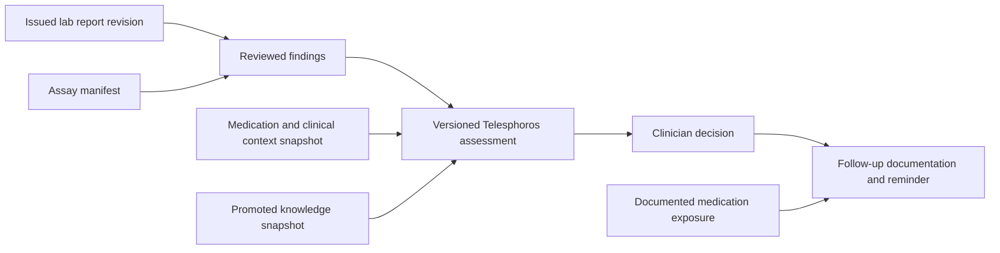

# PGx laboratory reporting and assessment service

Date: 2026-11-02
Status: Proposed design; clinical activation and implementation are not approved by this specification.

## Outcome

A physician uploads a report in chat, confirms the patient and missing context in a small dialog, and receives an assessment whose findings, limitations and sources can be inspected. A laboratory amendment or medication change creates a new assessment; it never rewrites what the laboratory originally issued. The patient page contains medications, decisions and follow-up documentation with an owner and reminder date.

The founder-supplied research informs this proposal. It is evidence to evaluate, not operating instructions. Personal reports and the original research attachment are not copied into the repository. All acceptance scenarios are invented.

## Deliverables

- [Report and assessment contracts](contracts/README.md): distinct ownership, fields, states, import boundary and output layout.
- [Coverage matrix](coverage.md): candidate modules and medication pathways, reference baseline, exclusions and the audit needed for a supported-coverage claim.
- [Laboratory procurement requirements](laboratory-requirements.md): information and validation evidence to request from a partner.
- [Acceptance scenarios](acceptance.md): success controls and failure cases for future implementations; these are not passing runtime tests.
- [Implementation proposal](plan.md): reuse of current mechanisms, proposed slices and unresolved decisions.
- [Evidence register](research.md): primary references and limits of this review.

## Record relationships

A decision does not itself establish medication exposure. A later report, context or knowledge revision creates a new assessment while retaining the previous basis.

## Requirements

| ID | Requirement | Acceptance evidence |
| --- | --- | --- |
| R01 | Preserve issued report revisions, exact source objects and issuer identity separately from derived extraction and assessments. | A01, A02, A09, A10 |
| R02 | Describe tested targets and unresolved findings without inferring normality from absence. Keep analytical, interpretive and clinical statuses separate. | A03–A06, A19 |
| R03 | Evaluate only a reviewed drug/result/context rule against an immutable input snapshot; retain all required genes and missing prerequisites. | A07, A08, A12, A13 |
| R04 | Archive promoted knowledge artifacts and supplemental notices; keep conflicts, retirement and rollback visible. | A08, A11, A17 |
| R05 | Generate equivalent PDF, structured output and chat presentations from the same released assessment. | A14, A15 |
| R06 | Preserve tenant authority, patient binding, independent review, idempotency, append-only history and ledger transactions. | A02, A09, A10, A16 |
| R07 | Link decisions and follow-ups to their actual basis without treating intent as medication exposure or improvement as causality. | A12, A18 |
| R08 | Publish analytical, interpretive, clinical and operational coverage separately. No universal CPIC or negative-risk claim follows from a gene count. | A06, A13, A19; release audit in coverage.md |

## Physician workflow

1. Upload from chat. Choose an existing patient or create one through the patient workflow. Confirm laboratory, accession and report date only when absent or uncertain; resolve identity mismatches before clinical association.
2. Show a compact receipt: received, awaiting review, or needs information. Import/extraction success is not clinical readiness. The independent capture-review requirement stays in force.
3. Show current-medication findings first, including holds and missing context. Expand to source finding, assay limitation, original laboratory interpretation, assessment rule/version and citation. Never use a generic green “safe” label.
4. Record an accepted/modified/rejected/deferred/clarification decision using the existing vocabulary. Confirm changes in the medication record separately.
5. Document follow-up with response, symptoms, adherence, information source and a short note. Set next date, timezone and responsible clinician. AI may draft a note from supplied facts; the clinician reviews and signs it. The note cannot create genetic facts, exposure or a prescribing rule.
6. For new findings or changed guidance, show a reassessment task and the old basis alongside the new one. Do not silently amend a prior decision or mark an existing reminder complete.

## Success criteria for a future release

Every displayed clinical statement traces to a released assessment and reviewed source rule. Every supported coverage row has an assay contract, context predicates, independent clinical examples, software acceptance evidence and named sign-off. Unknown or conflicting information stays visible. The first clinical release must have an approved intended use, laboratory qualification and clinical/regulatory review; this document establishes none of those approvals.

For the investor prototype, use synthetic laboratory packages and deliberately synthetic rules. A convincing demo can exercise this complete workflow before any real clinical rule is activated.
